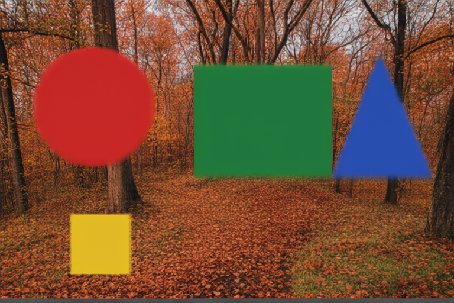

# Ming Image — Unified Inference (tinyv3 branch)

This branch hosts the unified Ming Image 0.1 inference runtime with two
interchangeable MLLM text encoders behind one CLI entry point (`infer.py`):

| Family | `mllm/config.json` `model_type` | Checkpoints | Tasks |
| --- | --- | --- | --- |
| **tinyv3** (primary on this branch) | `bailing_moe_v3_vl` | unified Preview package (weights distributed separately — see below) | text-to-image, image-edit |
| miniv2 (regression-covered) | `bailingmm_moe_v2_lite` | [Ming-Image-0.1-Design](https://huggingface.co/inclusionAI/Ming-Image-0.1-Design), [Ming-Image-0.1-Design-Layer](https://huggingface.co/inclusionAI/Ming-Image-0.1-Design-Layer) | text-to-image, image-edit, layer-decompose |

The family is auto-detected from the checkpoint's own `mllm/config.json`;
sampling defaults are family-specific and resolved from the checkpoint
contract (tinyv3 generation: 30 steps / CFG 1.0; miniv2 generation: 12 / 1.0,
layer: 12 / 2.0).

**Verified environment:** single NVIDIA L20Y (81.5 GB), BF16, CUDA 12.4,
Python 3.10, PyTorch 2.5.0. The inference commands and reference outputs were
validated on this configuration. Real H800 and non-NVIDIA hardware have not
been validated yet. Third parties targeting other hardware must run
the alignment flow in [docs/ALIGNMENT.md](docs/ALIGNMENT.md) to establish
numeric tolerances on their own stack; do not assume cross-hardware bitwise
equality from a fixed seed.

Measured on the verified L20Y configuration (reference only, do not
extrapolate to other hardware): model load ≈ 30 s; a 30-step 1024×1024
text-to-image sample ≈ 7 s; peak VRAM ≈ 35 GB.

## Install

Use an isolated Linux / Python 3.10 environment with a CUDA 12.4 toolkit and
C++ compiler available for FlashAttention. Install the base dependencies
before the KDA stack:

```bash
python3.10 -m venv .venv
source .venv/bin/activate
python -m pip install torch==2.5.0 torchvision==0.20.0 --index-url https://download.pytorch.org/whl/cu124
python -m pip install -r requirements-tinyv3-base.txt packaging ninja psutil
python -m pip install --no-deps triton==3.8.0 fla-core==0.5.2 flash-linear-attention==0.5.2
python -m pip install --no-build-isolation --no-deps flash-attn==2.7.4.post1
```

`requirements-tinyv3.txt` records the observed runtime versions. It is not a
single resolver-compatible install target: the standard Linux PyTorch 2.5
wheel pins an older Triton, while the reference KDA stack uses 3.8.0. The
staged commands deliberately override that dependency in this isolated
environment. GPU inference was validated on the recorded stack; a fresh
installation of this recipe has not yet been validated.

Hard requirements specific to the tinyv3 family:

- **fla-core** (KDA linear-attention kernels, imported as `fla`). There is no
  eager fallback: without these kernels the model fails at load time with an
  explicit `ImportError`.
- **triton==3.8.0** for the KDA kernels. Note triton 3.8 breaks torch 2.5
  inductor compilation; this codebase therefore runs the vendored vision
  RoPE helper eagerly by design (see the NOTE in
  `modeling_bailing_moe_v3_vl.py`).
- **flash-attn ≥ 2.6** (validated: 2.7.4.post1): the qwen3_moe_vit vision
  tower uses attention logit soft-capping, which older flash-attn builds do
  not support.

Attention defaults: tinyv3 → `sdpa`; miniv2 → `eager` (its LLM only
implements eager and FlashAttention 2 classes). `--attn-implementation`
overrides either. Do not claim eager attention as a general KDA substitute —
KDA always runs through the fla kernels.

To pin the code, check out this branch and record the commit:

```bash
git checkout Ming-Image-0.1-Design_tinyv3
git rev-parse HEAD   # pin this commit for reproducibility
```

## Model directory

`--model` accepts a local directory or an HF Hub repo ID. The unified
tinyv3 Preview package has this layout (component configs + weights; the
same layout the released miniv2 packages use):

```
Ming-Image-0.1-Unified-Preview/TinyV3-sft1024-iter1000/
├── mllm/            # bailing_moe_v3_vl MLLM (config.json declares model_type)
├── connector/       # query-token connector for image generation
├── mlp/             # direct-VLM condition projection
├── scheduler/
├── transformer/     # DiffusionTransformer + capability metadata
├── vae/             # 4-channel AutoencoderKLQwenImage (argmax encoding)
└── config.json
```

The tinyv3 weights are **not** downloadable from this repository or a public
Hub repo at this time: obtain the complete unified package through the
distribution channel you were given and pass its local path to `--model`.
The released miniv2 Hub repos above work unchanged.

## Run

Validate a checkpoint and task combination without loading weights:

```bash
python infer.py --model /path/to/model --task text-to-image \
  --prompt "A red circle on a white background" --width 1024 --height 1024 \
  --validate-only
```

Text-to-image (full reference case; the prompt stays in its fixture file so
no one hand-copies UTF-8 text):

```bash
python infer.py --model /path/to/model --task text-to-image \
  --prompt examples/smoke/t2i_fox_prompt.txt \
  --width 1024 --height 1024 --steps 30 --seed 42 \
  --output-dir outputs/t2i
```

Short connectivity smoke (2 steps; passing only means the path runs — it is
not a numeric acceptance run):

```bash
python infer.py --model /path/to/model --task text-to-image \
  --prompt examples/smoke/t2i_fox_prompt.txt \
  --width 1024 --height 1024 --steps 2 --seed 42 \
  --output-dir outputs/smoke
```

Image edit (output size follows the reference-image bucket; do not pass
`--width`/`--height`):

```bash
python infer.py --model /path/to/model --task image-edit \
  --input-image tests/assets/smoke_input.png \
  --prompt examples/smoke/edit_prompt.txt --steps 30 --seed 42 \
  --output-dir outputs/edit
```

## Reference outputs and alignment

Fixed-input reference bundles live in `examples/smoke/reference/` (token
inputs, replay noise, final pixels, hashes). To check your build against
them, capture the same case and compare segment by segment:

```bash
python tools/capture_case.py --model /path/to/model --task text-to-image \
  --prompt examples/smoke/t2i_fox_prompt.txt \
  --width 1024 --height 1024 --steps 30 --seed 42 \
  --output-dir /tmp/fox-capture
python tools/compare_case.py \
  --reference examples/smoke/reference --candidate /tmp/fox-capture
```

`compare_case.py` exits 0 when every available checked segment passes: token
IDs and initial noise must match exactly; the final image is compared by
pixel MAE/RMSE. Omitted condition/latent tensors are marked `absent` and
excluded from that verdict; a full per-step comparison is marked
`needs_review`. A passing public smoke comparison does not certify those
segments or a new hardware backend. See
[docs/ALIGNMENT.md](docs/ALIGNMENT.md) for the full protocol, threshold
basis, and known limitations.

| Case | Input | Size | Steps / CFG / seed | Output | Compare result |
| --- | --- | --- | --- | --- | --- |
| Text-to-image | `examples/smoke/t2i_fox_prompt.txt` | 1024×1024 | 30 / 1.0 / 42 | [reference.png](examples/smoke/reference/reference.png) | replay noise exact; pixel MAE 0.0 vs bundle on the verified L20Y stack |
| Image edit | `tests/assets/smoke_input.png` + `examples/smoke/edit_prompt.txt` | 768×512 (ref bucket) | 30 / 1.0 / 42 | [edit/reference.png](examples/smoke/reference/edit/reference.png) | replay noise exact; pixel MAE 0.0 vs bundle on the verified L20Y stack |




## miniv2 compatibility

The released Design / Design-Layer checkpoints run unchanged on this branch;
their original usage (including layer decomposition, transparent-background
prompt prefixes, and the structured-prompt workflow) is documented on
[`main`](https://github.com/inclusionAI/Ming-Image/tree/main). Family-specific
behavior on this branch:

| Aspect | tinyv3 | miniv2 |
| --- | --- | --- |
| Attention default | `sdpa` | `eager` |
| Generation steps / CFG | 30 / 1.0 | 12 / 1.0 |
| Layer-decompose | not supported (hard error) | 12 steps / CFG 2.0 |
| KDA / fla kernels | required | not used |
| Output size for image-edit | follows reference bucket | follows reference bucket |

## Verification

Fast contract tests do not require model weights:

```bash
python -m unittest -v tests.test_inference_profile
python -m unittest -v tests.test_padding
python -m unittest -v tests.test_unified_runtime
python -m unittest -v tests.test_compare_case
```

The alignment tools themselves are covered by the last two modules. A GPU
smoke test with both checkpoint families fixed:

```bash
export CUDA_VISIBLE_DEVICES=0
export MING_GENERATION_MODEL=/path/to/design-checkpoint
export MING_LAYER_MODEL=/path/to/design-layer-checkpoint
export MING_SMOKE_OUTPUT_DIR=/path/to/persistent/results
python -m unittest -v tests.test_inference_smoke.InferenceSmokeTest.test_two_step_showcase_smoke
```

## Deployment

- vLLM-Omni: see the [recipes](https://github.com/vllm-project/vllm-omni/blob/main/recipes/inclusionAI/Ming-Image.md)
  and [installation guide](https://docs.vllm.ai/projects/vllm-omni/en/latest/getting_started/quickstart/).

## Checkpoint contract

Each checkpoint declares its runtime capability in `transformer/config.json`:

| Family | `alignment_padding_mode` | `multi_frame_output` |
| --- | --- | ---: |
| Text-to-image / image-edit | `"zero_masked"` | `false` |
| Layer decomposition | `"learned"` | `true` |

Both fields must be present together, and the VAE component must be the
4-channel `AutoencoderKLQwenImage` (argmax reference encoding). Missing,
partial, or unknown values are errors; the loader never infers padding
behavior from a directory name or silently falls back to another mode.

Legacy packages that predate the component metadata are loaded strictly from
a root `inference_profile.json` during the compatibility window; when both
exist, the component configs are authoritative and any disagreement with the
legacy file is an error.
